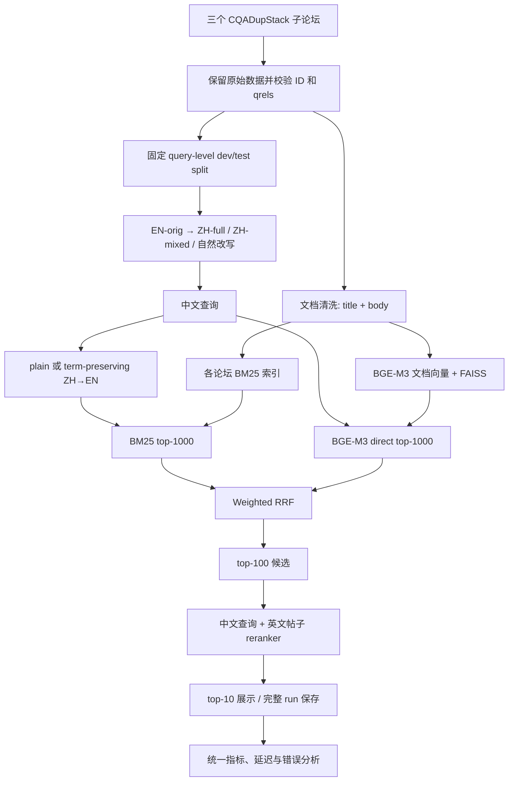

# Retrieval pipeline 设计

依据：`SI650_Project_Proposal.pdf`，2026-10-13。本文将 proposal 转为实施方案；标为初始值的参数需在 dev 上确认。尚未下载数据、调用翻译模型或运行检索实验。

## 1. 目标与范围

任务是 duplicate-question retrieval：给定中文技术问题，返回描述同一操作、环境和约束的英文问题，输出帖子 ID、排名和分数。主实验不生成答案，不做模型微调，也不把“主题相关”直接当成“同一问题”。

采用 proposal §3 的三个子论坛 android、programmers、unix，分别建立索引、检索和评估；§2 的“one selected technical subforum”应改成这一口径。子论坛由实验数据提供，不另加路由模型，也不把三个语料混合检索。

核心研究问题与控制条件：

| 问题 | 对比 | 固定条件 |
| --- | --- | --- |
| RQ1：翻译是否帮助 dense retrieval？ | BGE-M3(ZH) vs BGE-M3(MT(ZH)) | 同一查询、模型 revision、英文文档向量、索引和截断方式 |
| RQ2：英文术语保留是否有帮助？ | ZH-full vs ZH-mixed；plain MT vs term-preserving MT | 同一信息需求、检索器和生成预算；每次只改变一个因素 |
| RQ3：什么导致失败？ | 查询特征分组、英文 reference 与中文系统的逐查询差异 | 同一 qrels；人工检查翻译、目标操作、环境约束和标签噪声 |

默认候选架构是“英文译文 BM25 + 中文原查询 dense → RRF → 多语言 reranker”。最终是否使用它由 dev 决定，不能预先假定 hybrid 或翻译一定更好。英文查询只用于 reference 和离线诊断，不能提供给中文检索分支。

## 2. 整体数据流



Translate+dense 是独立分支：将 I 的英文译文送入同一个 BGE-M3 和 E 的同一索引，直接回答 RQ1。不能用“换一个英文 embedding 模型”替代这一对比。

## 3. 数据与防泄漏

### 文档与 ID

通过 `ir_datasets` 加载 `beir/cqadupstack/{android,programmers,unix}`。其文档有 `doc_id/text/title/tags`，查询有 `query_id/text/tags`；adapter 将文档 `text` 映射为 `body`。[官方数据接口](https://ir-datasets.com/beir.html)

proposal 的预期总量是 102,556 篇文档、2,647 条查询、5,064 条 qrels；导入后重新计算，不把这些数字当作已验证结果。逐论坛检查 ID 唯一性、每条 query 至少一条正例、qrels 文档存在、空文本和重复文本。跨论坛使用 `forum:source_id` 命名空间，保留原始 ID 便于追溯。

原始语料只读保存。清洗顺序：识别 HTML → 提取代码块并保留内容 → 去除标签、解码 HTML entities → 仅规范化普通文本空白 → 拼接 `title + "\n\n" + body`。不要对源文本统一 lowercase、删除标点或改写命令。已是纯文本的内容不要用简单 `<...>` 正则清洗，以免损坏代码。

审计 `Possible Duplicate` 等横幅、重复链接和锚文本。主实验建议删除能直接暴露重复关系的横幅块；保留原文及删除记录，并准备未删除版本作可比性检查。清洗规则必须固定且不依赖 qrels。严格区分正常技术链接与重复关系提示。检查 query 与 corpus 是否存在同一原始帖子；只有确认是同一帖子时才统一过滤 self-match，不能仅凭跨命名空间数字相等删除文档。

### 划分与翻译

先固定 query ID，再进行 prompt 调试。初始方案：seed=650，各论坛打乱后取约 20% dev，其余 test；所有语言版本和自然改写继承原 query 的 split。保存实际计数及 ID 列表；若按各论坛 floor(0.2N)，是 528 dev / 2,119 test，proposal 的 529/2,118 只是近似值。固定完整语料供两个 split 检索，不能把 corpus 按 query 比例切分。

审计同一 duplicate family 是否跨 split，并报告重叠。主方案保留 proposal 的 query-level 划分；若要改为 family-level split，必须在任何调参前决定，并接受比例偏离 20/80。检索和翻译模块都不能读取 qrels。

用模型 A 从英文标题生成配对 ZH-full/ZH-mixed；优先只替换术语片段，保持句式、操作和条件一致。两者都保护命令、flags、API、错误字符串、版本号；ZH-full 翻译可翻译的概念术语，ZH-mixed 保留其英文形式。记录成对术语表，但这张由 EN-orig 产生的逐查询表只供数据构建与审计，不能泄漏给 ZH→EN 的检索改写器。

手工抽检约 150 个 query 对，按论坛、特征和 split 分层；只能依据原查询核对语义，不能查看 relevant documents 或系统成绩后修改测试翻译。发现系统性问题时统一修正规则、重建受影响数据并保留版本。

30–50 个自然中文改写应由人工先阅读原问题、理解需求后重新表达，不能查看相关帖子或回译结果。单独报告 test 子集，不能把 dev 改写混入 test。它们能减轻模板式机器翻译偏差，但仍来源于英文问题，不能声称完全消除偏差或等价于真实中文用户日志。

## 4. 查询处理与翻译策略

| 产物 | 用途 | 可访问的信息 |
| --- | --- | --- |
| `en_orig` | 英文 reference | 原始 query title |
| `zh_full` / `zh_mixed` | 中文主实验 | 经审核的合成查询 |
| `mt_plain` | 翻译基线 | 中文输入、固定通用翻译 prompt |
| `mt_terms` | 改进 1 | 中文输入、冻结的领域术语表、输入中检测出的 literal spans |
| `hyde_en` | 改进 2，可选 | 中文输入、固定的假想问题生成 prompt |

ZH→EN 使用不同于 A 的模型 B；具体 provider/model 在预算和硬件确定后选定、记录，不在此虚构可用账户。plain 与 term-preserving 使用相同 B、温度和输出预算，以隔离策略差异。调试只看 dev；运行前冻结模型标识、prompt hash、术语表和生成参数。

术语保护将两件事分开：

1. **Literal protection**：识别输入中确实存在的命令、flags、API、版本和引用的报错；用不冲突的占位符替换，翻译后精确恢复并校验。原始 offset、原文与恢复结果均保存。
2. **Terminology mapping**：根据只用 dev 建立的词表和固定公开领域知识，将中文技术概念稳定映射为英文，例如“权限”→`permissions`。不能用 test 英文原标题、相关文档或 qrels 构造逐查询答案词表。

plain prompt 只要求忠实翻译，不使用上述占位符/术语表机制。记录 literal preservation rate，避免把“回译更像英文原题”误当成“检索更有效”。对两种 MT 报告与 EN-orig 的 token overlap，并记录词表覆盖率。

所有生成结果持久化缓存；cache key 至少包含输入 hash、provider/model revision、prompt hash、参数、术语表 hash。失败不得静默变为空查询；记录重试次数与失败状态，预算设上限。实验中的失败作为系统失败统计，保证不同系统使用同一评估 query 集；完成有效重试后再冻结数据。

## 5. 检索、融合与重排

### BM25

使用 Pyserini/Lucene，为每个论坛建立单一 `contents=title+body` 索引。固定 `k1=0.9, b=0.4`，这是 proposal 的基线参数，应显式设置，不依赖安装版本默认值。初始返回 top-1000。不使用 title boosting、query expansion 或自定义 analyzer 来改变主基线；记录 analyzer、stemming、stopword 和依赖版本。JSONL collection 可用 `id` 与 `contents` 字段。[Pyserini 索引说明](https://raw.githubusercontent.com/castorini/pyserini/master/docs/usage-index.md)

保留源代码文本不代表 Lucene 会精确匹配 `--flag` 或 `C++`；W1 应检查这些字符串的实际分词。若增加 keyword 字段或技术词 analyzer，作为独立 ablation，不与术语翻译同时修改。

### Dense retrieval

主模型固定为 `BAAI/bge-m3` 的 dense 模式。同一英文语料只编码一次，所有语言版本复用。BGE-M3 输出 1024 维向量、支持最长 8192 tokens，且不要求给 query 添加 instruction；sparse 和 multi-vector 能力暂不纳入核心矩阵。[官方模型卡](https://huggingface.co/BAAI/bge-m3)

初始 doc max_length=2048、query max_length=256、batch_size=8；长度均含模型特殊 token，batch 根据显存调整而不改变输入。先统计实际 tokenizer 长度和截断比例；若大量帖子被截断，在 dev 阶段统一调整并重建向量。所有正文输入优先保留标题，截断尾部；首轮不分 chunk，维持 post-level qrels。

向量显式 L2 normalize，并以 float32 存入每论坛一个 FAISS `IndexFlatIP`，query 也 normalize，用内积实现 cosine。该索引进行精确搜索，避免初始实验混入 ANN recall 损失。[FAISS 索引说明](https://github.com/facebookresearch/faiss/wiki/Faiss-indexes)

按 proposal 数量估算，102,556 × 1,024 × 4 bytes ≈ 401 MiB，仅为向量内存，不含模型、文本和运行时开销；这一规模没有必要先引入分布式向量数据库。模型编码可用 GPU；硬件、precision、耗时和实际峰值显存需实测。无 GPU 时先完成 BM25，不据此承诺 dense 的运行时间。

### Weighted RRF

主 hybrid 的两路为 `BM25(MT(q_zh))` 与 `Dense(q_zh)`，每路 top-1000，按 doc ID 合并去重：

```text
score(d) = alpha / (c + rank_bm25(d))
         + (1 - alpha) / (c + rank_dense(d))
```

rank 从 1 开始；未出现的分支贡献 0；c=60 固定；只在 dev 搜 alpha∈{0.25,0.5,0.75}，默认 0.5。额外报告 alpha=0/1 对应单分支结果，实现时不保留只有零权重分支命中的文档。分数相同按 doc ID 排序。不同分支的原始 BM25/cosine 分数不直接相加。

两种中文版本各自生成 MT，再分别做 hybrid。`BM25(MT(q)) + Dense(MT(q))` 可作为共享译文的附加消融，用于判断收益来自多路检索还是原中文语义；不替代主 RQ1 对比。直接中文 BM25 只做可选诊断，否则中文与英文的词面不匹配会干扰 baseline 解释。

### Reranker

建议 `BAAI/bge-reranker-v2-m3`，官方将其列为多语言 cross-encoder。[官方模型卡](https://huggingface.co/BAAI/bge-reranker-v2-m3)

对 dev 选出的最佳一阶段配置取 top-100，输入 `(原中文查询, 英文 title+body)`；初始 pair max_length=1024，保留 query 与标题、截断正文，明确记录 tokenizer 设置。dev 比较 depth∈{50,100} 后冻结。输出按 cross-encoder 分数排序，同分沿用一阶段顺序，未重排尾部保持原序。

top-100 的候选全部重排时 Recall@100 不变，改善应体现在 nDCG/MRR；增加深度才可能把第 100 名以外候选提升到 top-100。保存原 candidate ranking、rerank score 和最终顺序，不混合两种分数后重排整条列表。若评估工具按分数排序，TREC run 用严格单调的最终排序分数（如 `-rank`），原始分数放 sidecar。

固定 reranker 的中文 query 输入，防止把“候选集变化”和“reranker 的查询语言变化”混为一谈。若另比较译文 reranking，必须在同一 candidate pool 上做配对消融。

### HyDE（可选）

从中文生成一段简短英文“假想问题描述”，保留环境、目标和 literal strings，不生成解决方案、不补充输入没有的版本或根因。编码该文本检索同一 dense index。先比较 `Dense(q_zh)` 与 `Dense(hyde_en)`，再决定是否替换 hybrid dense 分支；一次只改一个环节。报告编造约束的人工检查结果、额外成本和延迟。若 W6 时间不足，优先完成术语保护与干净的消融，不压缩测试隔离流程。

## 6. 必须完成的实验矩阵

`v∈{full,mixed}`。所有系统共享 split、corpus 版本、qrels 与评估脚本。

| Run | Query | 检索 | 作用 |
| --- | --- | --- | --- |
| random | 无 | 论坛内均匀无放回采样 top-1000，5 seeds | 随机基线，指标取均值 |
| en_bm25 | EN-orig | BM25 | 英文词面 reference |
| en_dense | EN-orig | BGE-M3 | 英文语义 reference |
| direct_v | ZH-v | BGE-M3 | 直接 CLIR |
| mt_bm25_v | plain MT(ZH-v) | BM25 | 翻译词面基线 |
| mt_dense_v | plain MT(ZH-v) | BGE-M3 | RQ1 的受控对比 |
| hybrid_v | plain MT(ZH-v) / ZH-v | BM25 / dense + RRF | 互补召回 |
| terms_bm25_v | term MT(ZH-v) | BM25 | RQ2，术语策略对词面检索的影响 |
| terms_dense_v | term MT(ZH-v) | BGE-M3 | RQ2，术语策略对 dense 的影响 |
| best_stage1_rr | dev 最优输入策略 | 固定候选生成 + reranker | 重排收益 |
| best_terms | 与对应 plain 父系统相同 | 仅替换 MT，保留其余参数 | 改进 1，若父系统无 MT 则用最佳含 MT 系统 |
| hyde | 与对应 no-HyDE 父系统相同 | 仅改变 dense 查询表示 | 改进 2，可选 |

核心未重排矩阵共 15 个配置（random 另有 5 seeds），先完成这些再增加扩展。统一以 dev 三论坛 macro nDCG@10 选超参数，同分时选成本更低的配置；用全局 alpha，避免小 dev 集上逐论坛过拟合。

## 7. 模块和产物接口

以下是待实现的结构，不表示已有代码：

```text
configs/                 数据、模型、run matrix、冻结配置
prompts/                 成对中文生成、plain MT、term MT、HyDE
src/si650_retrieval/
  data.py                导出与完整性验证、split
  preprocessing.py       清洗、duplicate banner 审计
  query_variants.py       生成、缓存、literal 校验
  features.py             正则特征与术语标记
  indexing.py             BM25/FAISS 构建及 manifest
  retrieval.py            random / BM25 / dense
  fusion.py               weighted RRF
  reranking.py            固定候选集重排
  evaluation.py           per-query metrics / macro / 显著性
  analysis.py             特征切片、回译 overlap、错误分析
  cli.py                  统一命令入口
tests/                    关键正确性与小型集成验证
data/                     原始/清洗数据、query variants、split、人工标签
indexes/                  三论坛的 BM25 和 FAISS 索引
runs/                     TREC runs、分数 sidecar、metrics、manifest
reports/                  纳入 Git 的汇总表、图与最终分析
```

| 产物 | 最小字段 / 约束 |
| --- | --- |
| corpus JSONL | `forum, doc_id, source_doc_id, title, body, contents, content_hash, preprocessing_version` |
| query JSONL | `forum, query_id, source_query_id, split, en_orig, zh_full, zh_mixed, features, review_status` |
| transformation JSONL | `query_id, variant, strategy, input_hash, output_text, model, prompt_hash, protected_spans, status, tokens, cost, latency_ms` |
| qrels TSV | 原始评估 ID 映射后的 `query_id, iteration, doc_id, relevance`；与额外人工标签分开 |
| TREC run | `query_id Q0 doc_id rank score run_id`；无重复、rank 从 1 开始 |
| run manifest | Git commit、配置 hash、数据/split/prompt/index/model revision、依赖版本、seed、硬件、命令、时间、产物 hash |
| per-query metrics | `run_id, forum, query_id, nDCG@10, RR@10, R@100, latency_ms` |

检索接口可统一为 `retrieve(query_text, forum, top_k) -> list[Hit]`，其中 Hit 包含 `doc_id, rank, score`。fusion 只读 ranked hits；reranker 只读 query、候选和文档文本；evaluation 才接触 qrels。查询变体用 run manifest 区分，不能改变 qrels 的 query ID。

建议 CLI 依赖顺序：`prepare → split → variants → validate → index → retrieve → fuse → rerank → evaluate → analyze`。这些是接口设计，尚不可执行。每步支持 resume 和产物校验，索引的 corpus/model hash 不匹配时必须拒绝复用。

## 8. 评估与质量门槛

使用 `ir_measures` 的 `nDCG@10`、`RR@10` 和 `R@100`；对 query 的 RR 求均值即 MRR。按论坛分别求均值，再对三个论坛等权 macro average，不把全部 query 的均值误标为论坛 macro。缺少 run 结果的 query 仍属于评估集合，得分记零。[指标定义](https://ir-measur.es/en/latest/measures.html)

英文 reference 的约 0.30 只能作为 proposal 的粗略预期。三个子论坛子集、20/80 test、清洗和 analyzer 都会影响与完整 CQADupStack 公开成绩的可比性，不能设为必须通过的数值断言；应核对完全相同数据和配置的参考实验。

显著性用 query 配对的双侧 randomization test，初始 10,000 次交换，seed=650；统计量为三个论坛各自平均差的宏平均，保证与主表口径一致。经验 p 值采用 `(极端次数+1)/(置换次数+1)`。同一个 query 的 full/mixed 不是独立样本；分别配对比较，或在联合统计中按原 query 成组交换。

预注册主要 nDCG 对比：两个 v 的 direct vs mt_dense；direct 的 full vs mixed；plain MT BM25 的 full vs mixed；两个 v 上 terms vs plain 的 BM25 和 dense；hybrid vs 其匹配 direct；best stage1 vs reranked。对预注册检验族用 Holm 校正并报告 effect size。其他指标和特征分组作为描述/探索分析，不能在 test 上挑显著对比。

补充标注固定为 **2=同一问题，1=有帮助但不是同一问题，0=不相关**。proposal 括号顺序容易与数值产生歧义，实施时统一这一映射。冻结后按论坛各抽 10 个 test queries，汇集预先指定的 baseline、direct、hybrid、reranked top-10，按 query/doc 去重、打乱、隐藏系统名，两人独立标注，计算一致性并裁决分歧。报告池化集合上的 graded nDCG@10（预设线性 gain 0/1/2）、helpful@10 和 judgment coverage；这一小池不能替代完整 qrels，也不能据此估计全库 recall。

失败分析抽取最多 50 个“最佳中文 run top-10 无正例、英文 dense reference top-10 有正例”的 test queries；不足 50 则全部分析并报告数量。使用翻译错误、术语不匹配、细粒度条件遗漏、候选召回失败、重排失败、标签噪声等标签，允许多标签；“英文成功中文失败”只是筛选信号，不能直接证明翻译错误。特征分组报告样本数，尤其 literal 类很少，避免强结论。

延迟分别报告翻译、embedding、search、fusion、reranking 的均值和 p95，注明硬件、batch、warmup、缓存命中与否。end-to-end 分冷缓存和热缓存测量；记录模型 A 的数据构建成本与模型 B 的在线 MT/HyDE 成本，不能把离线缓存命中当作零成本翻译能力。

实现时需要的验证：

- 数据：ID/qrels 完整、split 无交集、变体不跨 split、所有评估 query 被覆盖。
- 文本：HTML 清洗不破坏代码，literal 占位符往返精确，冻结文本不受重新运行影响。
- 排名：小例子验证 RRF 缺失分支、去重与同分规则；FAISS 与 brute-force dot product 一致；rerank 不改变候选集合且尾部规则正确。
- 指标：手算小样例核对 nDCG/MRR/Recall、论坛 macro、零结果查询；打乱输入顺序不改变结果。
- 集成：在 dev 小样本完成 export→index→run→evaluate，不为 smoke test 读取 test 分数。

## 9. 对齐工作计划

| 周次 | 时间（2026） | 交付和验收 |
| --- | --- | --- |
| W1 | Oct 13–19 | 导出与审计数据；提前固定 split；三个 BM25 索引；random/英文 BM25 的 dev run；生成成对中文查询 |
| W2 | Oct 20–26 | 150 对人工审核、特征标记、duplicate banner 统计；冻结预处理与首版数据 |
| W3 | Oct 27–Nov 2 | 自然改写、模型 B 回译；translate+BM25；BGE 文档编码；英文与中文 dense dev runs |
| W4 | Nov 3–9 | translate+dense、RRF dev 搜索；完成 RQ1 初步表和 progress check |
| W5 | Nov 10–16 | reranker、term MT、关键消融和显著性脚本 |
| W6 | Nov 17–23 | HyDE 或消融；只用 dev 试标注、冻结标注规范及 test pooling 规则 |
| W7 | Nov 24–30 | 延期缓冲；若主线完成，再做 mMARCO 扩展 |
| W8 | Dec 1–7 | 冻结全部配置，一次性运行所有预注册 test 系统；随后做 30-query test pooling 标注和 50-query 错误分析 |
| W9 | Dec 8–14 | 报告、图表、限制与 RQ1–RQ3 结论 |
| W10 | Dec 15–21 | 修订、视频、代码整理与可复现实验说明 |

这里有两项刻意调整：split 从 W2 提前到 W1，避免先看全体英文成绩再划分；test pooled annotation 从 W6 移到 W8，避免一边查看测试候选一边继续调 prompt。test “只运行一次”指冻结后的一次最终评估阶段，可以批量运行预注册的多个系统；完成后不依据 test 结果再选参数。

## 10. mMARCO 扩展和优先级

主实验完成后再验证中文 mMARCO 与英文 MS MARCO 的 query ID、passage ID 和 qrels 对齐；不能仅凭标题相同假定映射成立。先抽 500 个 query，资源允许再到 1,000。它是独立的外域扩展，不能用来继续调主实验超参数。

为了避免给 8.8M passages 全量编码，用冻结的 ZH→EN plain MT + BM25 取 top-1000 英文候选，再对同一候选集比较中文 dense 与 MT dense；缓存候选文档向量，并记录候选并集实际规模。这是 **candidate-restricted reranking**，不是 full-corpus dense retrieval。必须报告 BM25 candidate Recall@1000、包含所有 sampled queries 的最终指标，并把候选外正例当作未召回，不能只保留正例进入候选的查询。

实施优先级：数据与英文基线 → 配对中文查询 → direct/MT dense 受控比较 → hybrid → term preservation 与 reranker → 错误分析；HyDE、BGE sparse、mMARCO 都是扩展。先保证 RQ1/RQ2 的可解释性和 RQ3 的证据，再增加系统复杂度。
